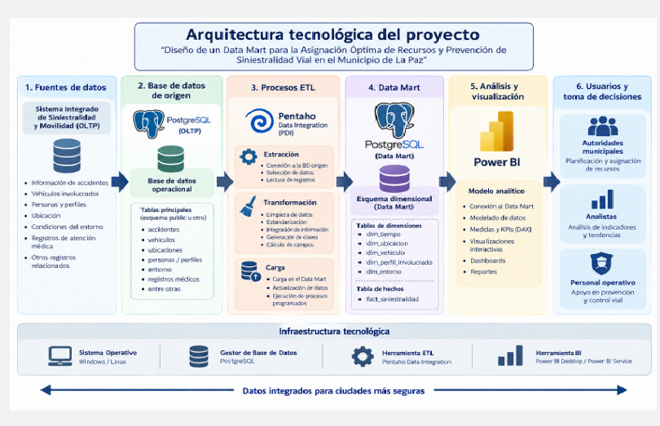
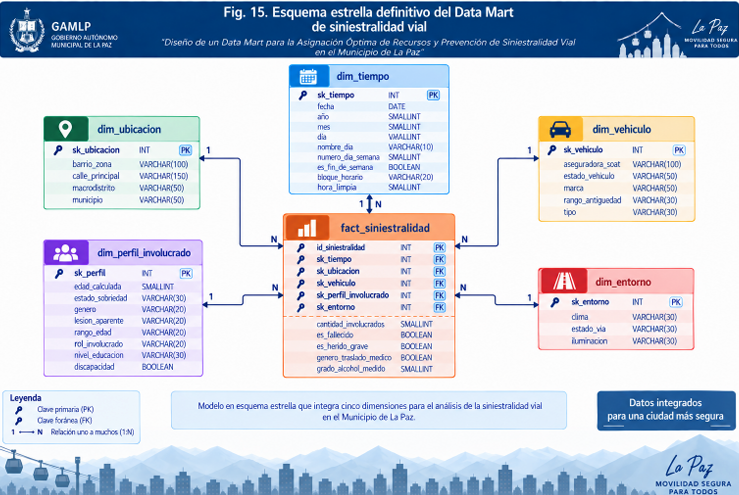
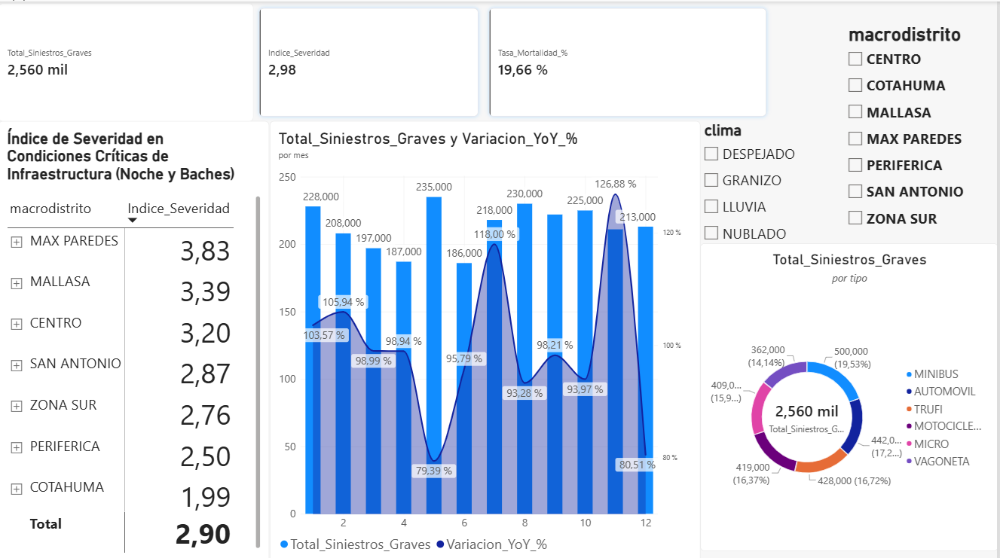

# 🚦 Data Mart & BI: Prevención de Siniestralidad Vial y Asignación de Recursos (La Paz)


> 🌐 **English Executive Summary:** End-to-end Business Intelligence and Data Engineering solution designed to optimize municipal budget allocation and reduce severe traffic accidents in La Paz, Bolivia. Built using the **HEFESTO BI methodology**, this project extracts and cleanses raw operational data from 10 relational tables (**PostgreSQL OLTP**), processes it through an automated **ETL pipeline in Pentaho Data Integration (PDI)**, loads it into a **Star Schema Data Mart**, and delivers actionable strategic, operational, and regulatory KPIs via **Power BI & DAX**. *(Full English summary at the bottom).*

---

## 📌 1. Problema de Negocio
La gestión de seguridad vial municipal suele enfrentarse a datos fragmentados en sistemas transaccionales (partes policiales, registros médicos, datos vehiculares y reportes climáticos). Esta dispersión impide responder preguntas críticas con rapidez, llevando a que el presupuesto de obras públicas o los operativos policiales se asignen de forma reactiva o subjetiva.

**Objetivo de la solución:** Transformar registros operativos dispersos en un **Data Mart multidimensional** que permita a las direcciones municipales tomar decisiones basadas en datos en tres niveles:
1. **Nivel Estratégico:** Priorizar el presupuesto de asfaltado e iluminación en zonas críticas y auditar el Retorno de Inversión (ROI) tras ejecutar obras viales.
2. **Nivel Operacional:** Optimizar los días y bloques horarios para operativos de alcoholemia (batidas), anticipar la saturación de traslados médicos según el clima y focalizar campañas de educación vial por perfil demográfico.
3. **Nivel Regulatorio:** Auditar la participación en accidentes fatales del parque automotor antiguo sin seguro (SOAT) y controlar a los sindicatos de transporte público con fallas mecánicas recurrentes.

---

## 🏗️ 2. Arquitectura de la Solución y Flujo ETL

El proyecto se desarrolló aplicando la metodología **HEFESTO** para soluciones de Data Warehousing y Business Intelligence:



### Etapa 1: Fuente Operacional (OLTP en PostgreSQL)
Extracción desde el *Sistema Integrado de Siniestralidad y Movilidad*, compuesto por **10 tablas relacionales**: `Parte_Policial`, `Ubicacion`, `Condicion_Entorno`, `Oficial_Transito`, `Vehiculo`, `Detalle_Vehiculo_Parte`, `Persona`, `Detalle_Persona_Parte`, `Centro_Medico` y `Traslado_Medico`.

### Etapa 2: Procesamiento y Limpieza de Datos (ETL con Pentaho PDI)
Diseño de transformaciones modulares (`.ktr`) para resolver problemas reales de calidad de datos:
* **Estandarización Temporal:** Limpieza y normalización de cadenas de fecha y hora para extraer año, mes, día de la semana, indicador booleano de fin de semana (`es_fin_de_semana`) y categorización en bloques horarios.
* **Normalización Geográfica y Categórica:** Homologación de nombres de macrodistritos, barrios/zonas, calles principales, marcas de vehículos y condiciones de entorno (clima, iluminación y estado de vía).
* **Ingeniería de Características (Feature Engineering):** Cálculo dinámico de la edad del involucrado al momento del siniestro (`edad_calculada`), agrupación en rangos etarios, categorización de antigüedad vehicular y banderas booleanas de gravedad (`es_fallecido`, `es_herido_grave`).
* **Integridad Referencial:** Generación de claves sustitutas (*Surrogate Keys - SK*) y búsqueda de dimensiones (*Dimension Lookup*) garantizando cero registros huérfanos en la tabla de hechos.

### Etapa 3: Modelado Dimensional (Star Schema en PostgreSQL)
Implementación de un esquema estrella optimizado para consultas analíticas rápidas:



* **Tabla de Hechos (`fact_siniestralidad`):** Contiene las claves foráneas dimensionales y las métricas cuantitativas (`cantidad_involucrados`, `es_fallecido`, `es_herido_grave`, `grado_alcohol_medido`, `genero_traslado_medico`).
* **5 Dimensiones Descriptivas:**
  * `dim_tiempo`: Jerarquía Año → Mes → Día → Bloque Horario.
  * `dim_ubicacion`: Jerarquía Municipio → Macrodistrito → Barrio/Zona → Calle Principal.
  * `dim_vehiculo`: Tipo de vehículo, marca, rango de antigüedad, estado del vehículo y aseguradora SOAT.
  * `dim_perfil_involucrado`: Rol, género, edad calculada, rango de edad, estado de sobriedad y lesión aparente.
  * `dim_entorno`: Condiciones de clima, iluminación y estado de la vía.

---

## 📊 3. Principales Resultados, KPIs y DAX en Power BI



A través del modelado analítico y medidas **DAX** en Power BI, se obtuvieron hallazgos clave para la gestión municipal:

* **Priorización de Presupuesto en Infraestructura Vial:** 
  Mediante el *Índice de Severidad Ponderado* filtrado por condiciones críticas (noche/iluminación deficiente y baches/mal estado de vía), se identificó que los macrodistritos **Max Paredes (Índice: 3.83)** y **Mallasa (Índice: 3.39)** superan ampliamente la media municipal (**2.90**), justificando la asignación prioritaria de contratos de mantenimiento vial.
  ```dax
  Indice_Severidad = 
  DIVIDE(
      (SUM(fact_siniestralidad[es_fallecido]) * 5) + (SUM(fact_siniestralidad[es_herido_grave]) * 2),
      SUM(fact_siniestralidad[cantidad_involucrados]),
      0
  )